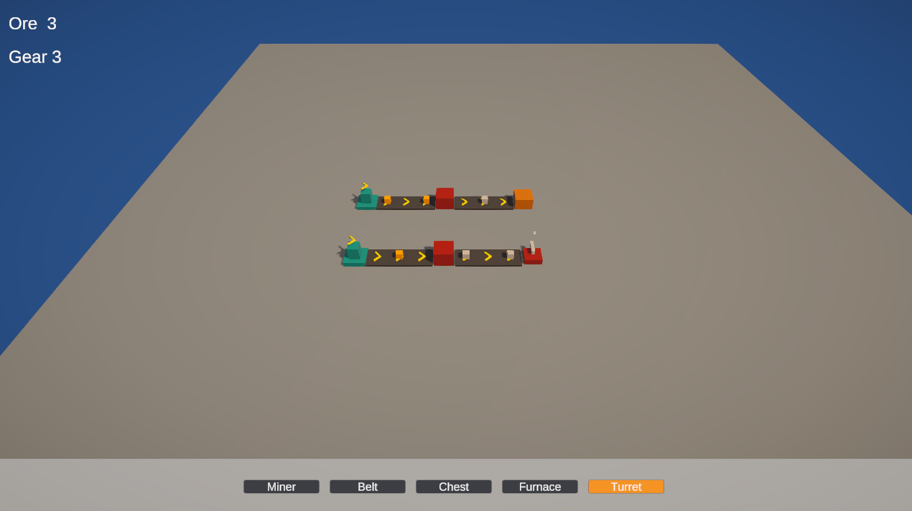
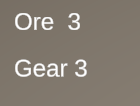
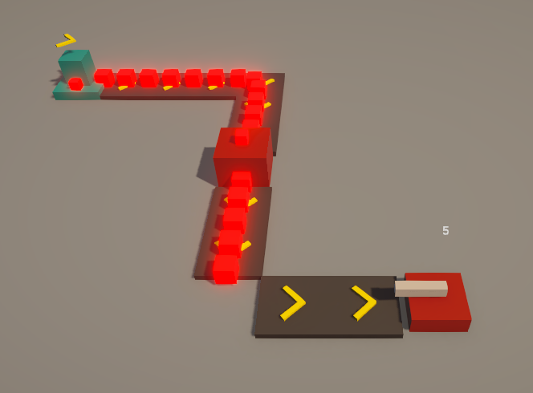

# Greybox Foundry

一个网格上的小型自动化工厂：采矿、运送、加工、装箱，然后看它什么时候堵住。

## 玩法

在 40 × 40 的网格上摆一条产线：

**采矿机** 每 2 秒挖出一颗矿石 → **传送带** 把它运走 → **熔炉** 把矿石炼成齿轮 → **箱子** 收下，最多装 50 个。

每条产线都有下游。下游满了，上游就停下来——该停的那一台头顶会亮起红灯，带子上的矿石变红堵在队列里。等下游腾出位置，整条线自己恢复。

炮塔是终点的消费者：只吃齿轮，不吃矿石，每颗齿轮能让炮口转 3 秒。

**没有输赢，也没有存档**——在网格上搭出一条一直转下去的线，就是全部的目标。

## 运行

1. 下载 `GreyboxFoundry_Windows.zip`
2. **解压整个文件夹**（不是只拿 exe，缺一个文件都打不开）
3. 双击 `GreyboxFoundry.exe`

Windows 10/11 · 1280 × 720 窗口 · 不需要安装 Unity

## 操作

| 操作 | 按键 |
| --- | --- |
| 平移视角 | `W` `A` `S` `D` |
| 缩放 | 鼠标滚轮 |
| 旋转视角 | `Q` / `E` |
| 选择建筑 | `1` 采矿机 · `2` 传送带 · `3` 箱子 · `4` 熔炉 · `5` 炮塔 |
| 切换朝向 | `R` |
| 建造 | 鼠标左键 |
| 拆除 | 鼠标右键 |

也可以直接点屏幕下方的按钮选建筑。左上角显示场上现有的矿石和齿轮数量。

## 传送带会拐弯

用 `R` 换朝向，传送带会在拐角处把矿石平滑地送过去——所以一条线不用笔直，可以绕着场地走。

下游满了，红灯亮起，矿石停在带子上排成队。灯亮着就是真的堵着——它不会一下一下地闪。

## 技术

Unity 6 · URP · C#。建筑、传送带、箱子、熔炉、炮塔共用一套「接收器」接口，交接逻辑只有一份。
